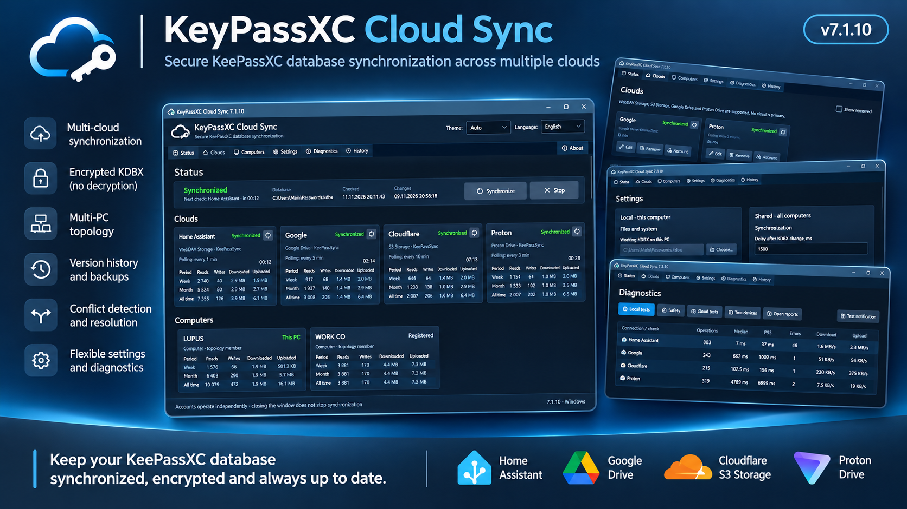
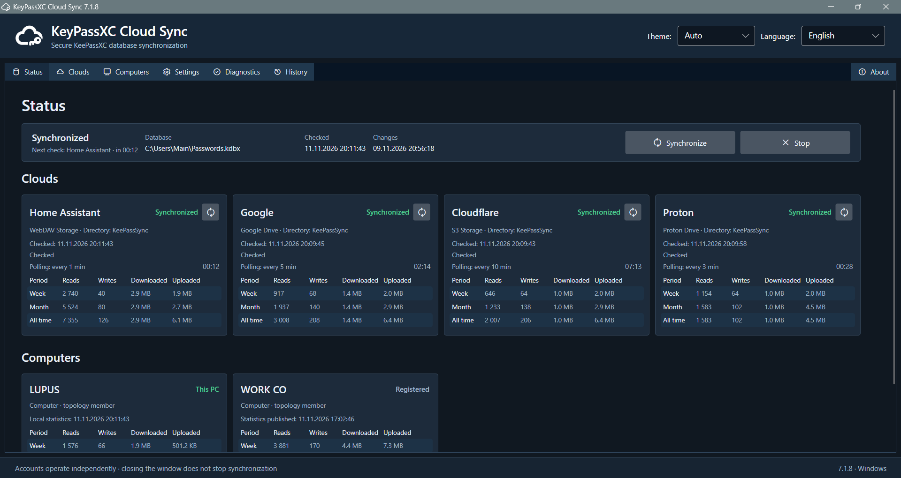
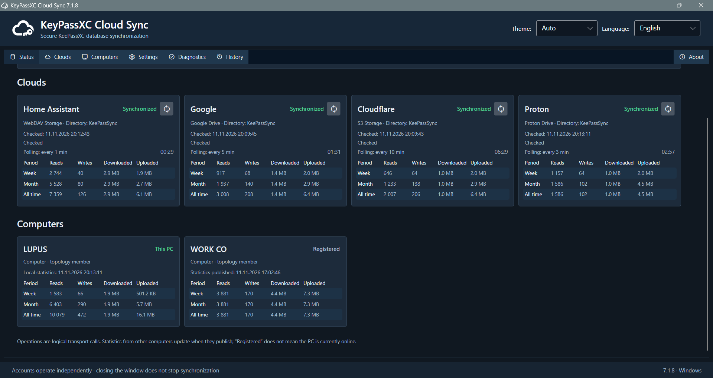
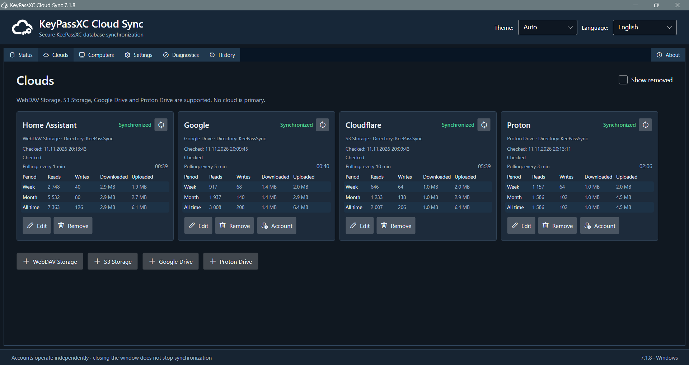
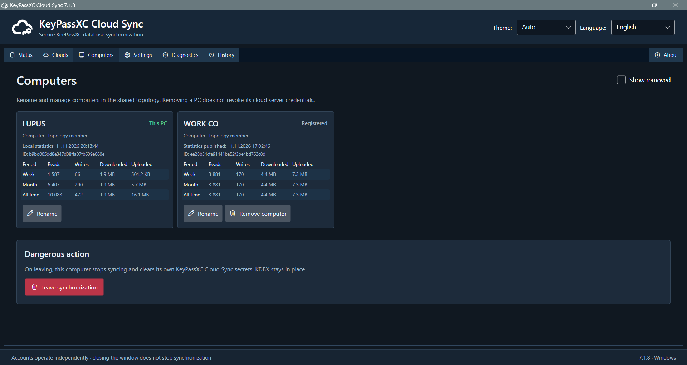
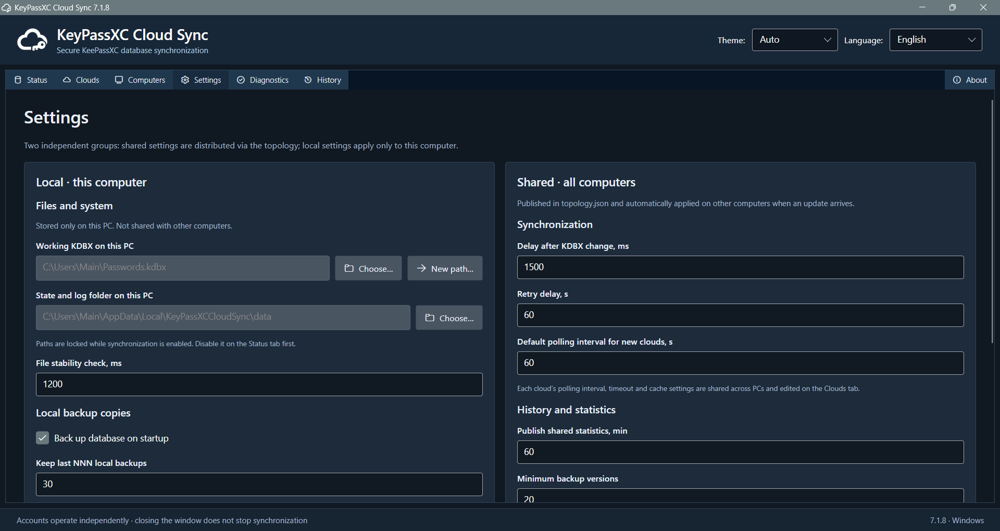
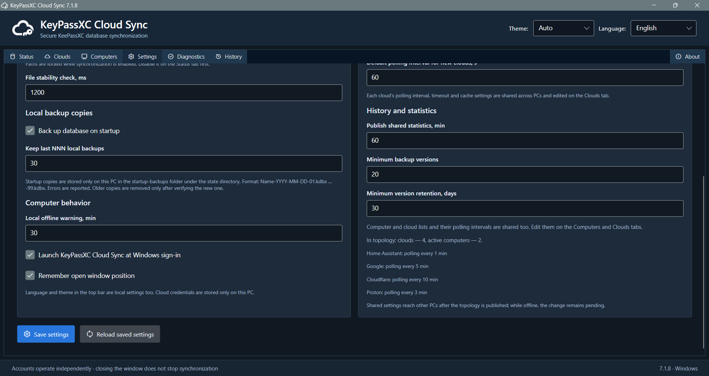
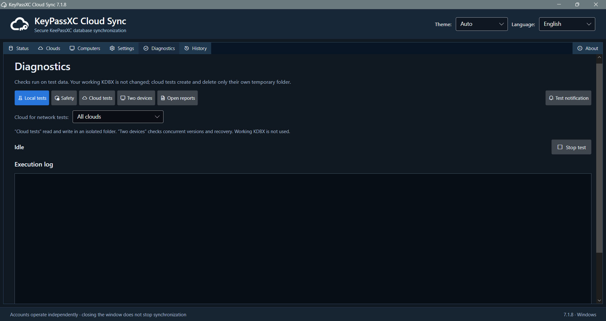
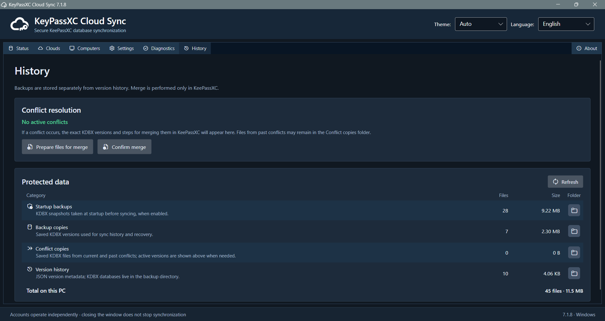
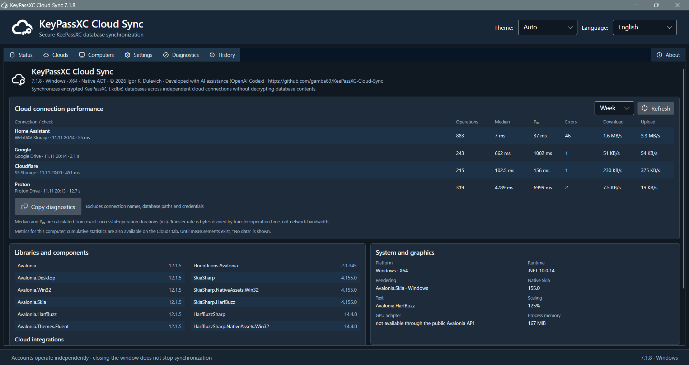

# KeyPassXC Cloud Sync

**Portable Windows desktop synchronizer for encrypted KeePassXC databases.**



[](.github/workflows/windows.yml)
[](LICENSE)

**Version:** 7.1.11 · **Platform:** Windows x64 · **Framework:** .NET 10, Avalonia 12 · **License:** MIT.

> **Version 7 development source — not production qualified.** Version 7.1.11
> keeps the 7.1 synchronization engine and refreshes the project documentation,
> README and GitHub Pages presentation with the selected promotional banner.
> Current UI screenshots remain in the illustrated user guide.
> This source has **not** been compiled or tested with real clouds; Windows .NET
> build, CI, safety tests and multi-PC acceptance are required before a stable
> release.

Version 7.1.11 updates the promotional header artwork for the repository and
GitHub Pages. The header is a visual illustration; the screenshots in the
gallery below are actual captures of the desktop application. No runtime or
synchronization behavior changes in this documentation update.


KeyPassXC Cloud Sync synchronizes encrypted `.kdbx` files between multiple
computers using independent cloud replicas. It does **not** decrypt the
database, read passwords, request the KeePassXC master password or upload a key
file. No cloud is designated as primary.

> **Back up your database independently before initial configuration.**
> Synchronization is not a backup strategy. Do not point two unrelated vaults at
> the same remote directory. This distribution does not include settings or
> local-state migration procedures; do not overwrite an existing installation or
> assume that an existing INI remains compatible.

## Capabilities

| Area | Behavior |
| --- | --- |
| Cloud providers | Google Drive (OAuth), Proton Drive (official CLI), S3 and S3-compatible services (including Cloudflare R2), HTTPS WebDAV |
| Replication | Multiple independently authenticated clouds, per-cloud polling intervals, shared topology of devices and replicas |
| Change detection | Local KDBX file monitor, network resume checks, periodic per-cloud polling, debounce and stable-file checks |
| Data safety | Immutable revision graph, no automatic vault merge, preflight conflict detection, per-vault lock, local backups and history retention |
| UI | Windows tray, normal/error/warning states, language selection (English, Russian, Ukrainian), light/dark/automatic theme |
| Diagnostics | Isolated local and cloud tests, status view, activity metrics, rotated logs and test reports |
| Packaging | Portable ZIP with NativeAOT executable, user guide and SHA-256 checksum; Proton CLI must be obtained separately if used |

The remote storage format has **schema version 2**. That is a wire-format
identifier, **not another application release**. A full description appears in
[Protocol](docs/PROTOCOL.md). A server without reliable conditional writes
cannot prevent every possible concurrent external update; the application
preserves discovered conflicting revisions for manual resolution.

## Screenshot gallery

The repository includes original application screenshots under `docs/images/`.
They appear below and are also reused by the user guide and public GitHub Pages
site. The promotional collage above serves as the primary visual banner.

### Status page



### Status page with cloud and computer sections



### Clouds page



### Computers page



### Settings page — upper section



### Settings page — lower section



### Diagnostics page



### History page



### About page



## Quick start

1. Obtain the Windows x64 portable ZIP or build from source on Windows using `build.bat` and the .NET 10 SDK. The Proton Drive CLI is not included; obtain it separately from Proton if you use that provider.
2. Make a separate offline backup of the encrypted `.kdbx` database and keep your KeePassXC key file separately.
3. Launch `KeyPassXCCloudSync.exe` and select the existing local KDBX and a **separate** local state directory.
4. Add one cloud connection in the **Clouds** tab; complete authorization. For Proton Drive, install the official CLI separately, place `proton-drive.exe` beside the app or on `PATH`, and authorize the CLI.
5. Save the configuration. In **Diagnostics**, run the isolated provider tests before enabling synchronization.
6. Check the read-only preflight. An unavailable or unauthenticated cloud may be deferred if at least one cloud is fully verified and the verified revision graph is safe. Confirm the partial-coverage warning; no unverified replica is assumed current. Identity mismatches, unsafe topology or corrupt metadata still block activation. Watch for **SYNCED**, **PARTIAL**, **CONFLICT**, **NEEDS_AUTH**, or **ERROR**.
7. Connect additional providers and computers one at a time; each computer must have its own local state folder and installation identity.

**Never publish access/refresh tokens, personal credentials, key files or
private KDBX material.** The embedded Google Desktop OAuth client ID and client
secret identify a public desktop application; they do not grant account access
by themselves. Review diagnostics before sharing them.

## Documentation

- [User guide](docs/USER_GUIDE.md) — setup, providers, daily operation, status, backup, conflict handling and removal.
- [Public GitHub Pages home page](docs/index.md) — product overview, screenshots and support links.
- [Privacy policy](docs/privacy.md) — data handling statement for users and Google OAuth review.

GitHub Pages deployment (once the updated `/docs` folder is on the publishing branch):
**Settings → Pages → Deploy from a branch → `main` → `/docs`**.
The site uses Jekyll to turn `index.md` and `privacy.md` (both with YAML
front matter) into HTML pages. The published URLs are
`https://gamba69.github.io/KeePassXC-Cloud-Sync/` and
`https://gamba69.github.io/KeePassXC-Cloud-Sync/privacy/`.
These URLs must be verified after deployment before entering them in Google
OAuth branding; the repository files alone do not publish the Pages site.

- [Configuration reference](docs/CONFIGURATION.md) — all supported INI sections, credentials and provider-specific options.
- [Architecture and platform boundary](docs/ARCHITECTURE.md) — assemblies, adapters, OS-specific services and porting.
- [Synchronization protocol](docs/PROTOCOL.md) — remote layout, revisions, topology, atomicity and safety invariants.
- [Build](docs/BUILD.md) and [testing](docs/TESTING.md) — build commands, individual test results, NativeAOT and troubleshooting failed checks.
- [Troubleshooting](docs/TROUBLESHOOTING.md) — CLI, OAuth, network, UI, logs, failed preflight and recovery.
- [Security model](docs/SECURITY_MODEL.md) and [security reporting](SECURITY.md).
- [MIT license](LICENSE) and [third-party icon notice](FLUENT_ICONS_NOTICE.txt).

## Repository structure

```text
.github/workflows/         Windows continuous-integration checks and build workflows
docs/                      English project documentation
src/                       Application source code
resources/                 App icons and packaging resources
tests/                     Unit, UI and audit checks
build.bat                  Windows build entry point
```
