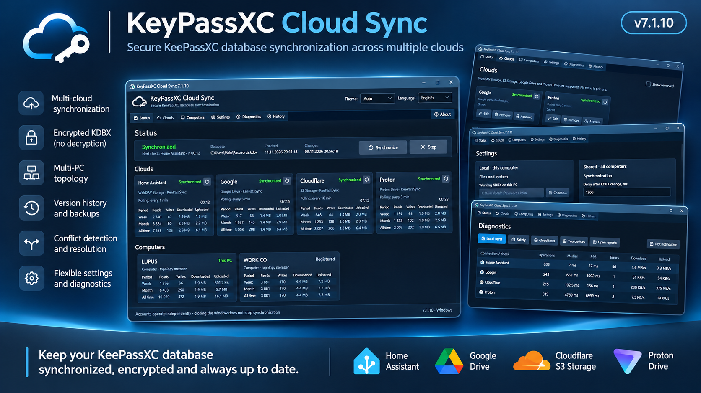
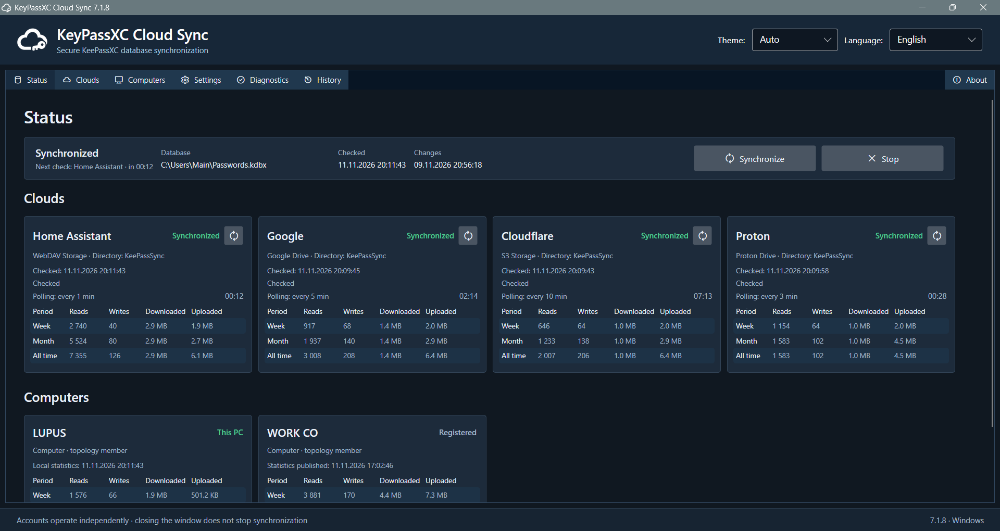
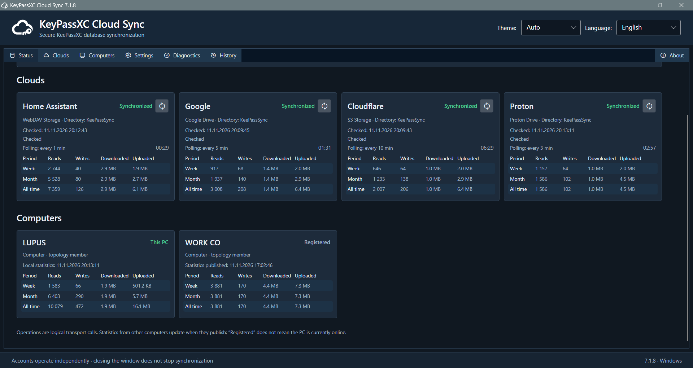
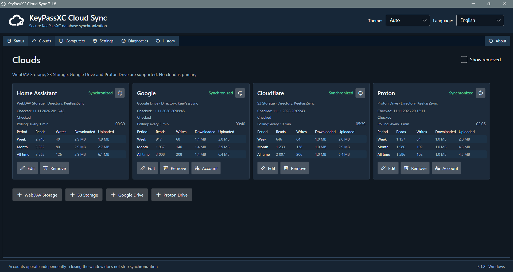
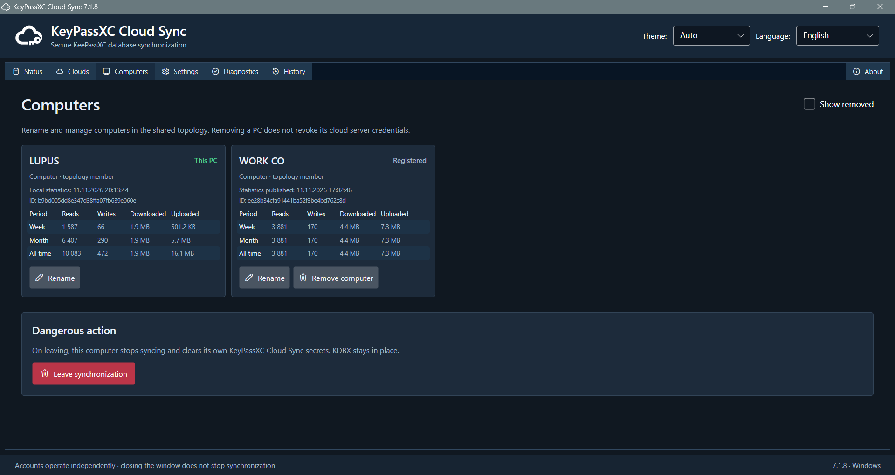
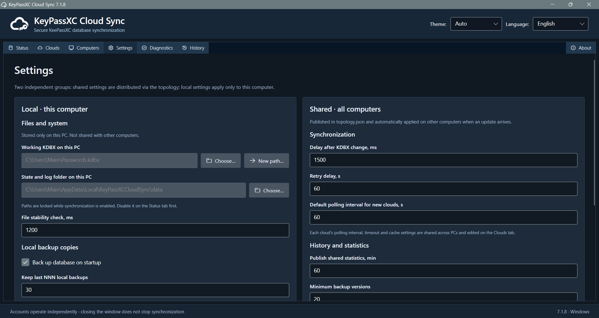
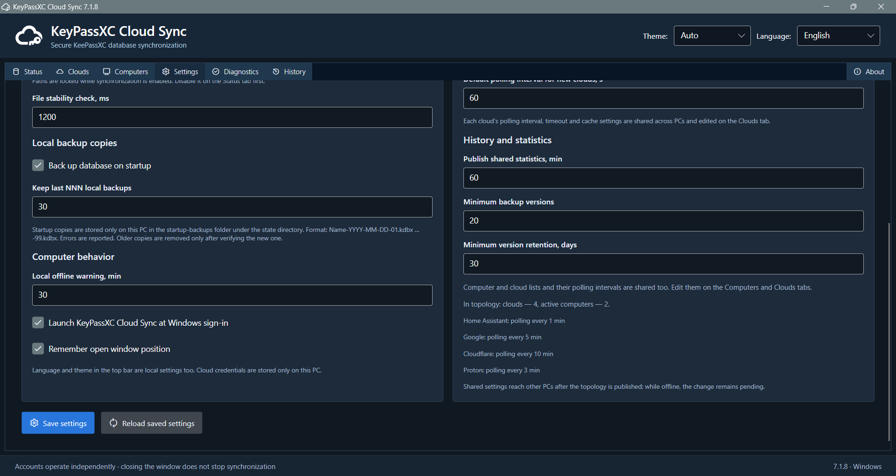
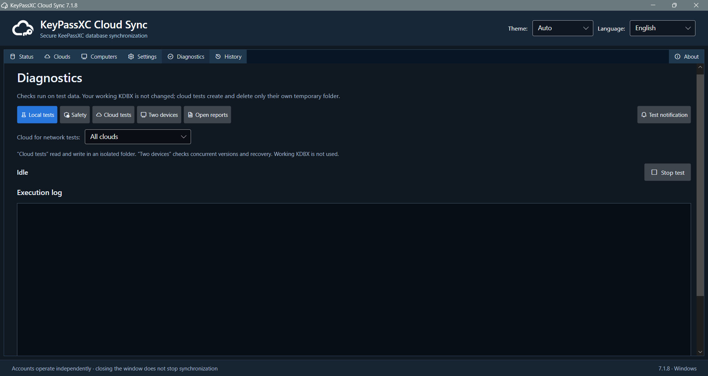
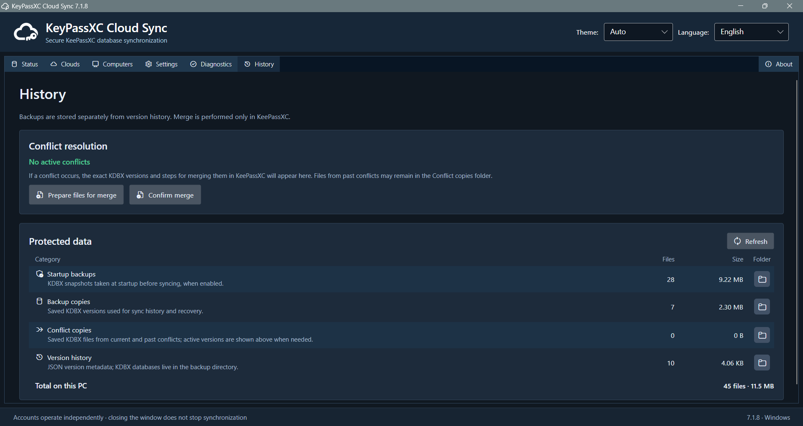
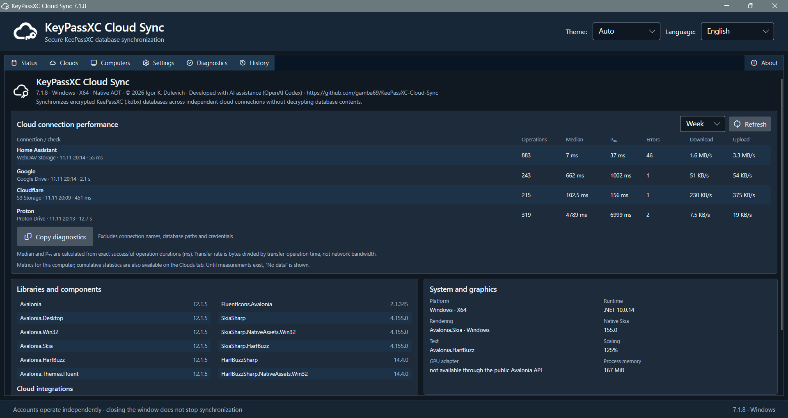

# User guide

## Requirements and deployment

- Windows x64, a working copy of KeePassXC or another application that can safely save `.kdbx` files, and sufficient disk space for local history and startup backups.
- At least one supported cloud account; each cloud requires its own provider-specific setup.
- Optional official Proton Drive CLI if that cloud is used. The desktop Proton Drive application alone does not replace the CLI.
- Published NativeAOT builds do not require a system-wide .NET runtime. Developers building source need the .NET 10 SDK.

Extract the release to a directory of your choice. There is no installer. For multiple independent vaults, use separate configuration and local state paths. Run `KeyPassXCCloudSync.exe`; the app starts normally in the foreground. Close the window to keep background synchronization in the tray when configured; use **Exit** from the tray when you want to terminate the process.

## First configuration

1. Make a manual, offline backup of your encrypted vault **outside the synchronized remote folders**. Include your separately protected key file in your own recovery plan.
2. Open **Settings**. Select the actual KDBX on this computer; do not pick a cloud-drive mirror that another sync utility already modifies. Choose a separate writable directory for `state.json`, local backups, history, conflicts and test reports.
3. Keep synchronization disabled until cloud connectivity and conflict preflight are verified.
4. Open **Clouds**, add a connection, give it a unique display name, and choose a new empty remote subdirectory (for example `KeePassSync`). The directory must not contain a different vault or another application's incompatible data layout.
5. Authorize the provider, save the connection and run **Diagnostics → Cloud tests**. The tests use an isolated randomly named test folder, not your working database.
6. Review the read-only preflight and enable synchronization. When local and remote KDBX files disagree without a provable common history, the application must not select one silently.
7. Make a non-sensitive test change in KeePassXC, save and verify successful synchronization. Recheck from a second device before depending on the setup.

## Provider setup

### Google Drive

The application connects via the Google Drive API using OAuth. Use the configured Desktop OAuth client; the refresh token is stored in the local Windows Credential Manager. Select the intended Google account in the sign-in browser and verify that the account shown in the application matches. Google scope restrictions may mean that an existing folder created outside the application is not visible; allow the app to create its own remote directory. A missing or revoked refresh token requires a new sign-in. The built-in Google Desktop OAuth client ID and client secret identify the publicly distributed application and are not confidential credentials. Never commit refresh/access tokens, user passwords or service-account keys. Existing connections with a different Client ID or an explicit ClientSecretCredential retain those overrides; sign in again if changing the OAuth client.

### Proton Drive

Obtain and install the **official** `proton-drive.exe` separately from Proton; it is **not included in the portable ZIP**. The application searches next to its own executable first (including the portable `tools/` folder), then in the Windows `PATH` directories. The cloud editor provides a Browse file-picker beside the path field for an explicit executable and an Auto button to return to automatic discovery. It does not ask for an unverified Proton account email. Authorize through the CLI using the same Windows user account. The internal writable root is `/my-files`; the configured **Cloud directory** is relative to that root and can be nested, such as `Passwords/KeePassSync`. The CLI manages its own cache and session; no cache directory field is exposed by the GUI. Use **Diagnostics** to verify access, download, upload and deletion using test data. The app cannot reliably independently attest the CLI account email; verify the CLI session.

### S3 or Cloudflare R2

Create the bucket and scoped application credentials at the provider. Configure the HTTPS endpoint, bucket name (the S3-specific root), region and access key. The key pair is stored in Windows Credential Manager. Cloudflare R2 often uses `auto` for the region; AWS S3 uses the actual region. Providers must support the operations and consistency needed by the V2 protocol. Do not put the bucket into the remote directory field a second time.

### HTTPS WebDAV

Use the actual WebDAV endpoint (not merely the provider's web management login page) and a dedicated account or application password with appropriate access. Verify the TLS certificate; disabling certificate verification is not supported. Some NAS and commercial-drive plans require WebDAV to be enabled separately. For reliable competing writes, strong ETags and `If-Match`/`If-None-Match` behavior are required; servers that do not provide CAS have limited concurrency guarantees.

## Synchronization and status

### Enabling with temporarily unavailable replicas

An unauthenticated cloud, unreachable server or provider timeout does **not** require you to remove that cloud from your configuration. Activation preflight examines each configured replica independently, then permits a **partial** start when at least one replica is fully inspected and its visible version graph and the local KDBX have a safe, consistent interpretation. The confirmation identifies each unverified cloud and warns that its versions have **not** been checked. The application performs the same read-only inspection again just before enabling; changed observations cancel activation.

Clouds that were skipped retain their configuration and will be retried by the normal worker. An available cloud can receive the current revision while unavailable replicas remain `NEEDS_AUTH` or `ERROR`; the overall status is `PARTIAL`, never `SYNCED`. Recovery triggers a fresh scan. A replica with the expected ancestry can catch up; independent heads require manual conflict resolution. An incompatible vault identity, invalid immutable history, unreliable remote revision, conflicting topology or missing confirmed history still blocks activation or publication. If **no** cloud can be verified, activation is denied. Preflight cannot rule out a conflict in a cloud that was offline; keep an independent backup before continuing.

The **Status** page uses one balanced horizontal panel with synchronization state and live activity, followed by clearly labeled vault, last-check and last-change fields. Each metadata field has a caption above its value. The panel uses comfortable inner spacing and compact 40-DIP actions rather than oversized buttons. Long paths, dates and status messages have full-text tooltips. At narrow widths the actions become icon-only, without stacking the panel into multiple rows.

The **Status** page summarizes the local vault and per-cloud states. **SYNCED** means the current version has been confirmed at all configured, available replicas *on this computer*. **PARTIAL** means only a subset is confirmed. **CONFLICT** means independent revisions need a user decision. **NEEDS_AUTH** means local access is not configured; **ERROR** indicates a failure. Not every network error is an authentication failure.

Each enabled cloud has its own asynchronous polling worker and interval. A slow provider cannot postpone routine checks of other providers. A change to the local KDBX triggers a safety reconciliation after debounce and stability checks. Remote checks primarily inspect metadata and device pointers; unchanged KDBX bodies should not be downloaded repeatedly. A paused vault does not publish KDBX changes, but topology and status checks can continue.

Use the compact refresh button on an individual cloud card to request **Sync now** for that provider without waiting for its normal interval. A repeated click during an active check schedules at most one additional check, never a concurrent duplicate of the same worker. The card displays the current operation and elapsed time while active, then the countdown to its next scan. A long request is not automatically considered failed: the underlying provider's timeout and retry policy decide whether a transport operation has failed. If a new KDBX version is found, the coordinator must inspect other possible heads before installing or publishing a result; this necessary safety sweep can wait for a slow or unavailable peer.

The **Clouds** page shows the provider, remote directory, last check, countdown and operation statistics. The **Computers** page shows known and archived participants. The **History** page provides revision and local startup-backup information. Diagnostics can emit detailed technical messages; treat them as potentially sensitive environment data and redact before sharing. The interface translates recognized network and OS failures into the selected RU/UA/EN language. Raw Windows/provider exception details are preserved for technical diagnosis and may be in the operating system language; never publish unredacted diagnostics.

## Interface walkthrough

The screenshots below reflect the current Windows desktop interface used in the
repository, README and public Pages site.

### Promotional overview

The following banner is a visual illustration; the individual screenshots
below show actual pages of the Windows desktop application.

### Status page

The main **Status** page summarizes the global result, the local vault path,
the last completed check, the timestamp of the last local change, the next
polling target and the immediate **Synchronize** / **Stop** actions.

When the window continues below the initial banner, the same page shows the
**Clouds** and **Computers** sections in one dashboard. This lets the operator
compare the global state with the per-cloud and per-computer cards without
leaving the page.

### Clouds page

The **Clouds** page is the administrative view for configured providers. It is
used to inspect status, edit provider settings, remove a connection or open the
provider-specific account dialog when one exists. The same card layout is reused
for WebDAV, S3/R2, Google Drive and Proton Drive.

### Computers page

The **Computers** page manages the shared topology. It lists known computers,
shows the current computer, exposes rename/remove actions, and includes the
local **Leave synchronization** action in a clearly separated danger zone.

### Settings page

The **Settings** page is split into local settings for the current computer and
shared settings that propagate through the topology. The upper part shows path
selection, file-stability settings and synchronization timing defaults.

The lower part continues with backup retention, local computer behavior and the
remaining shared history/statistics options, followed by the save/reload
commands.

### Diagnostics page

The **Diagnostics** page runs isolated checks. It contains test categories,
cloud selection, notification test support and a live execution log area. The
working KDBX is not modified by the isolated cloud test folder.

### History page

The **History** page combines manual conflict-resolution controls with the
protected-data inventory. The protected-data table lists startup backups, backup
copies, conflict copies and the JSON version-history metadata directory.

### About page

The **About** page combines the connection-performance table with library,
platform and rendering information. This page is also the most convenient place
for copying sanitized diagnostics before reporting an issue.

## Conflicts, disappearance and recovery

When manually resolving a conflict, **Prepare Merge** makes a fresh folder under `data/merge/` with working copies of the active branches. Merge in KeePassXC, verify the result, and either save it as a new KDBX or overwrite **one prepared working copy**. Then select that saved file using **Confirm Merge**. Never edit `data/conflicts/`: those files are immutable originals, and the program verifies them against the original version hashes. If the result is byte-identical to one original version, the program requires an additional explicit confirmation because the other branch’s changes are being deliberately discarded. All original branches remain in history.
If independent KDBX revisions appear, do not manually overwrite one remote file with another. Preserve both copies and merge in KeePassXC, then save a deliberate resolved revision. Never delete the sole known good revision to make a status look green. If the remote working file disappears, the application must not delete the local KDBX to mirror that deletion. If a cloud is inaccessible, distinguish network failure, permissions, missing identity and conflicting history before resuming writes.

Keep at least the configured retention set: by default, a minimum of 20 backups and all backups younger than 30 days (subject to the documented ancestry and protected-conflict rules). Optional startup backups are local and disabled by default; if enabled they run before the first synchronization cycle. Local startup-backup errors produce warnings, not silent destructive recovery.

## New computer and multi-cloud topology

Every computer must have a unique installation identity and **its own state directory**. Do not copy `state.json` from a different PC. On a new computer, connect to a known remote vault and complete local provider authorization; the program may advertise cloud connections as suggestions, but secrets do not propagate in topology. Shared topology changes may be queued; publication and acknowledgment are distinct events. Deleting an archived cloud record does **not** erase remote KDBX history. Removing a computer from topology does **not** revoke its credentials at the cloud provider: rotate or revoke those separately.

## Tray, startup and shutdown

The tray icon may change color to represent attention/error states. The taskbar uses a platform-specific status indicator when Windows ignores dynamically replaced icons. On Windows, optional autostart is stored under the user's Run registry key. **Exit** terminates the process; closing the main window does not necessarily stop synchronization. Use the visible status and logs to confirm the service is idle or stopped before maintenance.

## Local files and privacy

The encrypted database is a user-chosen `.kdbx` file. `state.json`, `backup/`, `startup-backups/`, `history/`, `conflicts/`, topology cache and logs belong to the private local data directory, not a shared copy of another machine's state. UI geometry and view flags are stored locally under the application data `ui/` folder. OAuth and S3/WebDAV secrets are kept in Windows Credential Manager; Proton CLI uses its own session. Never upload these files or unredacted diagnostic logs to GitHub.

## Existing installations and initial configuration

This repository is a clean initial-release distribution. It does not upgrade or rewrite configuration/state from earlier unpublished builds. Do not install over a running sync process. Take an independent copy of the local KDBX and protected data, use a separate working folder when evaluating this release, and configure each provider explicitly. An enabled cloud with unsupported options will be rejected rather than silently redirected to another remote path. Never reuse another machine's `state.json` or remove a remote directory to force a new start. The protocol retains schema 2 for safe interpretation of supported cloud data; this does not provide a general-purpose local migration path.

## Performance statistics in 7.1

Operation duration statistics start afresh with the 7.1 statistics format. Both the median and nearest-rank P₉₅ are calculated from exact millisecond duration counts, without coarse bins or upper-bound approximations. Existing exact-duration measurements from 7.1 are retained, including when earlier JSON has an unused interval field. Other recorded counters (operations, transferred bytes and failures) are retained on upgrade. Older peer duration snapshots are ignored until the remote computer upgrades and publishes its 7.1 statistics. This affects performance statistics only: vault versions, KDBX backups, merge history, connection settings and synchronization safety state are never reset.
